<!-- ═══════════════ HEADER ═══════════════ -->


<div align="center">


</div>

---

## 👨‍💻 About Me

```php
<?php

class Omar
{
    public string $role      = "Software Engineer (Full Stack / Backend)";
    public string $education = "B.Sc. Computer Science, Assiut University (2026)";
    public string $location  = "Cairo, Egypt";

    public array $stack = ["Laravel", "Spring Boot", "React", "Angular", "MySQL", "PostgreSQL", "Redis", "Docker"];

    public array $currentlyExploring = ["CI/CD", "GitHub Actions", "Docker", "System Design", "Database Indexing", "Message Brokers", "gRPC / GraphQL / SOAP"];

    public function mindset(): string
    {
        return "Clean architecture, secure by default, and shipped end to end.";
    }
}
```

- 🎓 Fresh **Computer Science graduate (2026)** with **2 years** of hands-on experience building full-stack and backend systems.
- ⚙️ I design **RESTful APIs**, **authentication flows**, **real-time features**, and **normalized relational databases**, then take them all the way to the frontend and deployment.
- 🤖 I like putting **AI inside real products**: streamed chat, local LLM inference with Ollama, and safety layers around the model.
- 🔄 I adapt quickly: PHP/Laravel, Java/Spring, or JS/TS, I pick the right tool for the job.
- 🎨 Former **Senior Graphic Designer** (60+ projects), so I care about UI/UX as much as the backend.

---

## 🛠️ Tech Arsenal

<div align="center">

**Languages**


**Backend & Frameworks**


**Frontend**


**Databases & Caching**


**Tools & DevOps**


</div>

<details>
<summary><b>📚 Full skill breakdown (click to expand)</b></summary>
<br/>

| Area | What I work with |
|---|---|
| **Languages** | PHP, Java, JavaScript, TypeScript, SQL, C, C++, Python, C#, familiar with Go |
| **Backend** | Laravel, Spring Boot, REST APIs, MVC, Eloquent ORM, Doctrine DBAL/ORM, Hibernate, Spring Data JPA |
| **Auth & Security** | Session-based auth, JWT, OAuth 2.0, Laravel Sanctum, Socialite, RBAC, Policies & Gates, OWASP Top 10 |
| **Databases** | MySQL, PostgreSQL, MongoDB, Redis, relational design, normalization, indexing, N+1 optimization |
| **Frontend** | React, Angular, HTML5, CSS3, Bootstrap, Tailwind CSS |
| **Real-time & AI** | WebSockets, Laravel Reverb, Laravel Echo, Pusher, LLM API integration, Ollama (Phi-3) |
| **Tools & Testing** | Git, GitHub, Docker & Docker Compose, Postman, Swagger, JUnit, Mockito, Unit Testing |
| **Design** | Figma, Adobe XD, UI/UX wireframing, branding |

</details>

---

## 🚀 Featured Projects

<table>
  <tr>
    <td width="50%" valign="top">

### 🩺 CareLens
**AI-Powered Healthcare Assistant** · *Graduation Project*

`Laravel` `React` `MySQL` `Ollama (Phi-3)` `Reverb`

- Role-based platform for **Patients, Doctors & Admins**
- **Streamed AI chat** with persistent conversations and patient-specific context, running a local Phi-3 model
- 🚨 **Emergency-safety middleware** that detects critical symptoms *before* the AI is called
- Doctor–patient workflows: treatment plans, medication adherence, symptom logs
- **Real-time notifications** via private WebSocket channels

    </td>
    <td width="50%" valign="top">

### 📝 OLog
**Hybrid Real-Time Blog Platform**

`Laravel 12` `PHP 8.2` `Pusher` `Socialite` `MySQL`

- **One-to-one real-time chat** with WebSockets
- Follower-based feed, posts CRUD, categories, tags, likes, bookmarks, nested comments
- Google OAuth login, email verification, password reset
- ERD with **12+ entities / ~70 attributes**, indexing and query optimization

    </td>
  </tr>
  <tr>
    <td width="50%" valign="top">

### 📚 Online Book Store
**Full Stack Graduation Project** · *Pulse by Solutions*

`Spring Boot` `Spring Security` `JWT` `Hibernate` `PostgreSQL` `Angular`

- Layered Spring Boot backend (Controller → Service → Repository → Entity → DTO)
- **JWT + BCrypt**, role-based access, global exception handling
- Jakarta Bean Validation with a unified response envelope
- Customer storefront and **admin dashboard**

    </td>
    <td width="50%" valign="top">

### 🛒 E-Commerce Platform
**Vanilla PHP · Doctrine ORM**

`PHP` `Doctrine DBAL/ORM` `JWT` `Stripe` `Bootstrap`

- Custom **JWT auth flow** (token generation, validation, cookies)
- Persistent cart, checkout, **Stripe Checkout** with payment verification
- Live AJAX search suggestions and async cart updates
- Admin role-based access control

    </td>
  </tr>
  <tr>
    <td colspan="2" valign="top">

### ⚡ Cache Proxy Server
`ReactPHP` `Guzzle` · An async HTTP proxy that intercepts and caches requests to cut repeat latency.

    </td>
  </tr>
</table>

> 🔗 Browse the source on my [repositories page](https://github.com/Omar132555?tab=repositories).

---

## 💼 Experience

```text
2026 ──● Full Stack Spring/Hibernate Training · Pulse by Solutions (Sep – Oct 2026)
        │  Spring Boot registration API: email OTP, BCrypt, Redis expiry + rate limiting,
        │  DTOs, centralized exception handling, Docker Compose (PostgreSQL, Redis, Mailpit)
        │
2022 ──● Full Stack Engineer (Self-Learning) (May 2022 – Jul 2026)
        │  Laravel + React apps, REST APIs, WebSockets, OAuth, automated email systems
        │
2024 ──● Media Manager / WordPress Developer (Nov 2024 – May 2025)
        │  Built & maintained the brand website, improved UI/UX, rebuilt brand identity
        │
2022 ──● Senior Graphic Designer · Self-Employed (Jan 2022 – Nov 2024)
           60+ projects: e-commerce, branding, packaging, UI/UX wireframes (XD & Figma)
```

---

## 🎓 Education & Certifications

| | |
|---|---|
| 🎓 **B.Sc. Computer Science**, Assiut University | 2026 |
| 🏅 **Full Stack Web Development (Spring / Hibernate) Internship**, Pulse by Solutions | REST, Spring Security + JWT, JUnit/Mockito, Angular |
| 🏅 **Fundamentals of Backend Engineering**, Udemy (Hussein Nasser) | TCP/UDP, HTTP/1-3, gRPC, TLS, proxies, load balancing |
| 🏅 **Web Development Track**, Udacity / EgyptFWD | HTML5, CSS3, ES6+, Node.js & Express |
| 🏅 **OWASP Top 10**, ITI | Access control, SQLi, XSS, secure coding |

---

## 📊 GitHub Stats

<div align="center">


</div>

---

---

## 🧠 Currently Focusing On

<div align="center">


</div>

- 🔁 **CI/CD pipelines** and automating build, test and deploy with **GitHub Actions**
- 🐳 Going deeper with **Docker** (containers, images, Compose)
- 🏗️ **System design**: building scalable, reliable backends
- ⚡ **Database indexing** and how it speeds up queries
- 📨 **Message brokers** for async, decoupled services
- 🔌 API styles compared: **gRPC, GraphQL and SOAP**
- 💼 Looking for a **Software Engineer / Backend Developer** role where I can grow and ship real products

---

## 📫 Let's Connect

<div align="center">

[](mailto:omar.mostafa1325@gmail.com)
[](https://www.linkedin.com/in/omar-mostafa-5b7897246)
[](https://github.com/Omar132555)

<br/>


<br/>

<i>⭐ If you like something here, drop a star. It keeps me motivated!</i>

</div>


